# ambientCG: Ground materials

**27 assets from [ambientCG](https://ambientcg.com), dedicated to the public domain under [CC0](https://docs.ambientcg.com/license/).** Use them in any game, free or paid, and change them however you like; no credit is needed.

PBR materials as 1K and 2K JPG maps (colour, normal GL and DX, roughness, AO, displacement), one folder per resolution. 874.0 MB in all.

This is a copy kept by [zuujis-cc0](https://github.com/zuujis-cc0) so game makers can take single files from GitHub. It is not made by or affiliated with ambientCG: the originals, often in more formats and higher resolutions, are on [ambientcg.com](https://ambientcg.com). If they help you, consider [supporting ambientCG](https://www.patreon.com/ambientCG).

Every file is listed in [MANIFEST.tsv](MANIFEST.tsv) with its size and SHA-256. More free assets: [the Zuujis collection](https://github.com/zuujis-cc0/free-game-assets#readme).

| | | | |
| :-: | :-: | :-: | :-: |
| <a href="Ground082L">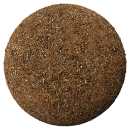</a> <b><a href="Ground082L">Ground 082 L</a></b> by ambientCG · <a href="https://ambientcg.com/a/Ground082L">source</a> | <a href="Ground082S">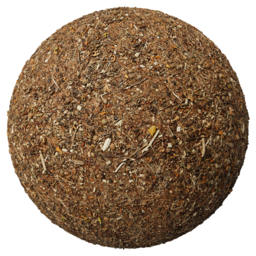</a> <b><a href="Ground082S">Ground 082 S</a></b> by ambientCG · <a href="https://ambientcg.com/a/Ground082S">source</a> | <a href="Ground083">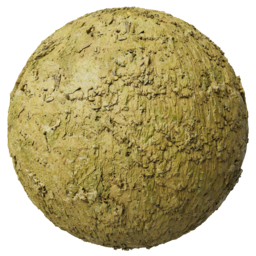</a> <b><a href="Ground083">Ground 083</a></b> by ambientCG · <a href="https://ambientcg.com/a/Ground083">source</a> | <a href="Ground084">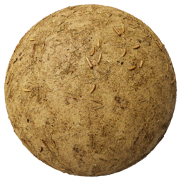</a> <b><a href="Ground084">Ground 084</a></b> by ambientCG · <a href="https://ambientcg.com/a/Ground084">source</a> |
| <a href="Ground085">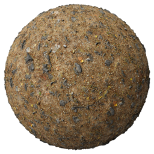</a> <b><a href="Ground085">Ground 085</a></b> by ambientCG · <a href="https://ambientcg.com/a/Ground085">source</a> | <a href="Ground086">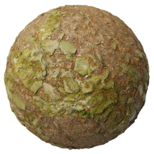</a> <b><a href="Ground086">Ground 086</a></b> by ambientCG · <a href="https://ambientcg.com/a/Ground086">source</a> | <a href="Ground087">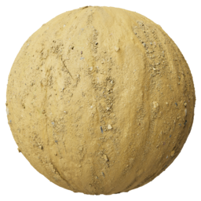</a> <b><a href="Ground087">Ground 087</a></b> by ambientCG · <a href="https://ambientcg.com/a/Ground087">source</a> | <a href="Ground088">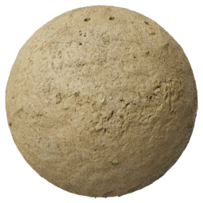</a> <b><a href="Ground088">Ground 088</a></b> by ambientCG · <a href="https://ambientcg.com/a/Ground088">source</a> |
| <a href="Ground089">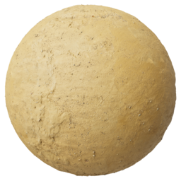</a> <b><a href="Ground089">Ground 089</a></b> by ambientCG · <a href="https://ambientcg.com/a/Ground089">source</a> | <a href="Ground090">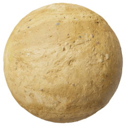</a> <b><a href="Ground090">Ground 090</a></b> by ambientCG · <a href="https://ambientcg.com/a/Ground090">source</a> | <a href="Ground091">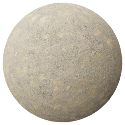</a> <b><a href="Ground091">Ground 091</a></b> by ambientCG · <a href="https://ambientcg.com/a/Ground091">source</a> | <a href="Ground092A">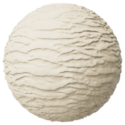</a> <b><a href="Ground092A">Ground 092 A</a></b> by ambientCG · <a href="https://ambientcg.com/a/Ground092A">source</a> |
| <a href="Ground092B">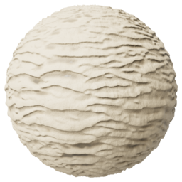</a> <b><a href="Ground092B">Ground 092 B</a></b> by ambientCG · <a href="https://ambientcg.com/a/Ground092B">source</a> | <a href="Ground092C">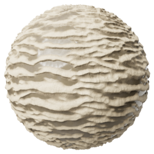</a> <b><a href="Ground092C">Ground 092 C</a></b> by ambientCG · <a href="https://ambientcg.com/a/Ground092C">source</a> | <a href="Ground093A">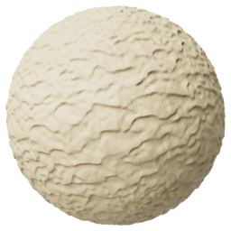</a> <b><a href="Ground093A">Ground 093 A</a></b> by ambientCG · <a href="https://ambientcg.com/a/Ground093A">source</a> | <a href="Ground093B">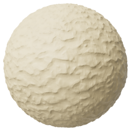</a> <b><a href="Ground093B">Ground 093 B</a></b> by ambientCG · <a href="https://ambientcg.com/a/Ground093B">source</a> |
| <a href="Ground093C">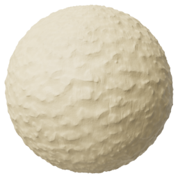</a> <b><a href="Ground093C">Ground 093 C</a></b> by ambientCG · <a href="https://ambientcg.com/a/Ground093C">source</a> | <a href="Ground094A">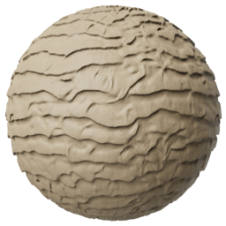</a> <b><a href="Ground094A">Ground 094 A</a></b> by ambientCG · <a href="https://ambientcg.com/a/Ground094A">source</a> | <a href="Ground094B">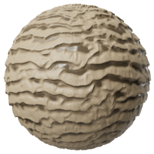</a> <b><a href="Ground094B">Ground 094 B</a></b> by ambientCG · <a href="https://ambientcg.com/a/Ground094B">source</a> | <a href="Ground094C">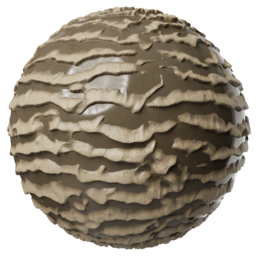</a> <b><a href="Ground094C">Ground 094 C</a></b> by ambientCG · <a href="https://ambientcg.com/a/Ground094C">source</a> |
| <a href="Ground095A">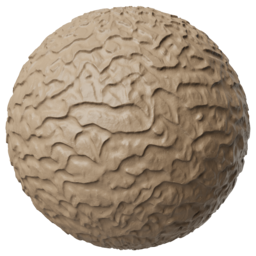</a> <b><a href="Ground095A">Ground 095 A</a></b> by ambientCG · <a href="https://ambientcg.com/a/Ground095A">source</a> | <a href="Ground095B">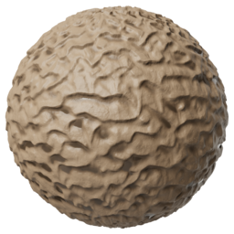</a> <b><a href="Ground095B">Ground 095 B</a></b> by ambientCG · <a href="https://ambientcg.com/a/Ground095B">source</a> |  <b><a href="Ground096A">Ground 096 A</a></b> by ambientCG · <a href="https://ambientcg.com/a/Ground096A">source</a> | <a href="Ground096B">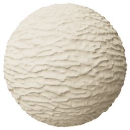</a> <b><a href="Ground096B">Ground 096 B</a></b> by ambientCG · <a href="https://ambientcg.com/a/Ground096B">source</a> |
| <a href="Ground097">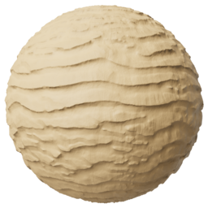</a> <b><a href="Ground097">Ground 097</a></b> by ambientCG · <a href="https://ambientcg.com/a/Ground097">source</a> | <a href="Ground098">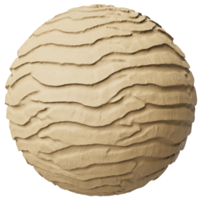</a> <b><a href="Ground098">Ground 098</a></b> by ambientCG · <a href="https://ambientcg.com/a/Ground098">source</a> | <a href="Ground099">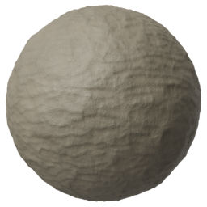</a> <b><a href="Ground099">Ground 099</a></b> by ambientCG · <a href="https://ambientcg.com/a/Ground099">source</a> |  |

---

Kept up to date by this repository's own [update workflow](.github/workflows/update.yml), with code and plan from [cc0-mirror](https://github.com/zuujis-cc0/cc0-mirror). Something wrong? [Open an issue there](https://github.com/zuujis-cc0/cc0-mirror/issues/new) or use the [private report form](https://games.zuujis.com/report).
